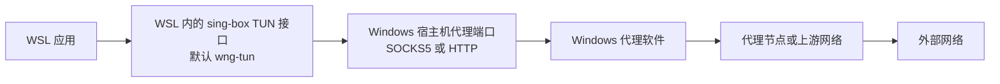
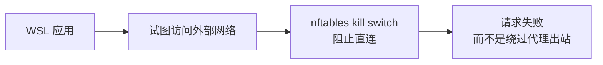

# wsl-netguard

`wsl-netguard` 是一个面向 WSL 的网络守卫 CLI。它在 WSL 内使用 `sing-box` TUN 接管出站流量，将流量转发到 Windows 宿主机上的代理软件，并通过 `nftables` kill switch 防止 WSL 在代理不可用时绕过代理直连外部网络。

这个项目不绑定某一个 Windows 代理客户端。只要代理软件能在 Windows 侧提供可从 WSL 访问的 SOCKS5 或 HTTP 代理端口，理论上都可以作为上游，例如 v2rayN、Clash Verge / Mihomo、sing-box、Hiddify、NekoRay 或其他本地代理客户端。

## 项目状态

当前仓库处于早期 MVP 阶段，核心命令、配置渲染、诊断、恢复、版本信息、GitHub Release 构建和基础测试已经存在。不同 WSL 发行版的安装差异、包管理器分发和完整手工验收清单仍会继续完善。

本项目全程使用 Codex 辅助开发、测试和文档整理。开发过程中参考并使用了 [ECC](https://github.com/affaan-m/ECC) 的工程规范内容，感谢 ECC 项目提供的规则与实践启发。

如果使用下方一键安装脚本，脚本会自动下载 release 产物并安装 `wsl-netguard` 受管理文件。手工安装流程则假设你已经获得可执行文件 `wsl-netguard`，并且 WSL 内具备运行 `sing-box`、`nftables` 和 systemd 服务的基础环境。

## 解决的问题

很多开发者在 Windows 上已经配置好了代理客户端，但 WSL 内的开发工具、包管理器和构建工具仍可能出现以下问题：

- 只配置 `http_proxy` / `all_proxy` 覆盖不完整，部分程序仍会直连。
- WSL2 的 Windows 宿主机地址可能随重启变化，静态配置容易失效。
- 代理客户端关闭或端口不可达时，WSL 可能绕过代理直接访问外部网络。
- 手写 `nftables` 规则有误时可能导致 WSL 断网，且恢复成本高。
- 使用 `flush ruleset` 等粗暴操作可能破坏 Docker、Kubernetes、kind、k3s 或用户已有防火墙规则。

`wsl-netguard` 的目标是把这些操作收敛为可重复、可诊断、可关闭、可救援的 CLI 流程。

## 工作原理

典型流量路径如下：



当代理软件不可达时：



工具启动时会动态检测 Windows 宿主机 IP，并在检测时排除自己管理的 TUN 接口，避免把 `wng-tun` 误判为原始网关。运行时生成的 sing-box 配置、nftables 规则和状态文件会写入 `/run/wsl-netguard`。

## 功能特性

- 使用 `sing-box` TUN 透明接管 WSL 出站流量。
- 支持 Windows 侧 SOCKS5 或 HTTP 代理端口。
- 动态检测 Windows 宿主机 IP，不硬编码宿主机地址。
- 提供 `dev` 和 `strict` 两种网络边界模式。
- 使用 `nftables` kill switch 阻止 WSL 直连外部网络。
- 只管理自己的 `table inet wsl_netguard`，不清空系统规则集。
- 提供 `disable`、`uninstall`、`rescue` 和手工救援步骤。
- 提供 `status`、`doctor`、`test`、`logs`、`render` 和 JSON 诊断导出。

## 非目标

- 不管理 Windows 代理软件的节点、订阅、分流规则或登录自启。
- 不自动修改 Windows 防火墙。
- 不替代 v2rayN、Mihomo、sing-box 等完整代理客户端。
- 不保证 `ping` 通过代理，因为 SOCKS5 / HTTP 代理通常不代理 ICMP。
- 不管理所有 WSL 发行版的包源差异，尤其是 `sing-box` 的发行版安装方式。

## 代理软件兼容性

Windows 侧代理软件需要满足以下条件：

- 在 Windows 上运行并监听 SOCKS5 或 HTTP 代理端口。
- 允许来自 WSL 虚拟网段的连接，很多客户端中该选项称为 Allow LAN、允许局域网连接或监听局域网。
- Windows 防火墙允许 WSL 访问该监听端口。
- 代理端口与 `wsl-netguard` 配置一致。

`wsl-netguard` 的内置默认端口是：

```text
SOCKS5: 10808
HTTP:   10809
```

这些端口只是常见默认值，不是协议限制。你可以把它们改成任意代理客户端实际监听的端口。

如果使用 v2rayN，需要注意 v2rayN 常见默认是混合端口 `10808`。这个端口可以同时处理 SOCKS5 和 HTTP 代理请求，不需要把 HTTP 代理理解为单独的 `10809` 端口。使用 v2rayN 时，通常保持 `proxy_protocol` 为 `socks` 即可；如果切换为 `http`，请把 `http_port` 也设置为 `10808`。

注意：当前部分诊断输出和测试名仍沿用历史命名 `v2rayn_socks` / `v2rayn_http`。它们表示 Windows 宿主机上的 SOCKS5 / HTTP 代理端口可达性，不代表只能使用 v2rayN。

## 环境要求

Windows 侧：

- 已运行一个可从 WSL 访问的代理客户端。
- 代理客户端已开启局域网访问或绑定到 WSL 可访问的地址。
- Windows 防火墙允许 WSL 访问代理端口。

WSL 侧：

- systemd 可用。
- 已安装 `sing-box`、`nft`、`ip`、`curl`。
- `/dev/net/tun` 可用。
- 修改 systemd、nftables、接口和 `/etc` 时使用 `sudo`。

可选工具：

- `journalctl` 用于查看服务日志。
- `resolvectl`、`nc` 等工具可改善诊断体验。

## 受管理资源

`wsl-netguard` 只应创建、修改或删除以下资源：

```text
/usr/local/bin/wsl-netguard
/etc/wsl-netguard/config.json
/etc/wsl-netguard/sing-box.template.json
/etc/systemd/system/wsl-netguard-killswitch.service
/etc/systemd/system/wsl-netguard-sing-box.service
/run/wsl-netguard/sing-box.json
/run/wsl-netguard/nftables.nft
/run/wsl-netguard/nftables.check.nft
/run/wsl-netguard/state.json
table inet wsl_netguard
wng-tun
```

它不会使用 `flush ruleset`，也不应该删除用户、Docker、Kubernetes、kind、k3s 或发行版管理的 nftables 规则。

## 配置

默认配置文件路径：

```text
/etc/wsl-netguard/config.json
```

默认配置：

```json
{
  "mode": "dev",
  "proxy_protocol": "socks",
  "socks_port": 10808,
  "http_port": 10809,
  "tun_interface": "wng-tun",
  "tun_address": "172.19.0.1/30",
  "dns_strategy": "ipv4_only"
}
```

字段说明：

| 字段 | 默认值 | 说明 |
| --- | --- | --- |
| `mode` | `dev` | 网络边界模式，可选 `dev` 或 `strict` |
| `proxy_protocol` | `socks` | 上游代理协议，可选 `socks` 或 `http` |
| `socks_port` | `10808` | Windows 宿主机 SOCKS5 代理端口 |
| `http_port` | `10809` | Windows 宿主机 HTTP 代理端口 |
| `tun_interface` | `wng-tun` | `wsl-netguard` 管理的 TUN 接口名 |
| `tun_address` | `172.19.0.1/30` | TUN 接口 IPv4 CIDR 地址 |
| `dns_strategy` | `ipv4_only` | sing-box DNS 策略 |

常用配置命令：

```bash
wsl-netguard config show
sudo wsl-netguard config set mode dev
sudo wsl-netguard config set mode strict
sudo wsl-netguard config set proxy-protocol socks
sudo wsl-netguard config set proxy-protocol http
sudo wsl-netguard config set socks-port 10808
sudo wsl-netguard config set http-port 10809
sudo wsl-netguard config set tun-interface wng-tun
```

v2rayN 混合端口 `10808` 示例：

```bash
sudo wsl-netguard config set proxy-protocol socks
sudo wsl-netguard config set socks-port 10808
sudo wsl-netguard config set http-port 10808
```

切换代理协议示例：

```bash
sudo wsl-netguard config set proxy-protocol http
sudo wsl-netguard config set http-port 7890
sudo wsl-netguard restart
```

如果你的 Windows 代理客户端只提供 SOCKS5：

```bash
sudo wsl-netguard config set proxy-protocol socks
sudo wsl-netguard config set socks-port 7891
sudo wsl-netguard restart
```

## 网络模式

### dev 模式

`dev` 是默认模式，适合日常开发。

允许：

- loopback 本机回环流量。
- 已建立连接的回包。
- 已进入 `wng-tun` 的流量。
- WSL 到 Windows 宿主机的通信。

阻止：

- WSL 直接访问外部网络。

这个模式默认保留 Windows 与 WSL 之间的开发通信，例如 VSCode Remote WSL、JetBrains WSL toolchain、Windows 浏览器访问 WSL dev server、调试器和语言服务器连接。

### strict 模式

`strict` 模式只允许 WSL 访问 Windows 宿主机上的配置代理端口。

允许：

- loopback 本机回环流量。
- 已建立连接的回包。
- 已进入 `wng-tun` 的流量。
- 到 Windows 宿主机代理端口的 TCP 流量。
- 到 Windows 宿主机 SOCKS 端口的 UDP 流量。

阻止：

- WSL 直接访问外部网络。
- WSL 访问 Windows 宿主机上的非白名单端口。

`strict` 可以降低 WSL 通过 Windows 上其他代理、端口转发器或网关绕过指定代理端口的可能，但也可能影响 IDE、调试器和 dev server 流量。切换前建议先确认你依赖的本地开发端口。

```bash
sudo wsl-netguard mode strict
```

恢复开发模式：

```bash
sudo wsl-netguard mode dev
```

模式变更后，如果服务已启用，建议重启运行时配置：

```bash
sudo wsl-netguard restart
```

## 使用方式

### 在线一键安装（推荐）

在线安装脚本位于 GitHub raw 地址，可以直接在 WSL 内执行：

```bash
curl -fsSL https://raw.githubusercontent.com/shanlvb/wsl-netguard/main/install.sh | bash
```

脚本会执行以下动作：

- 确认当前环境是 WSL。
- 尝试通过系统包管理器安装常见基础依赖，例如 `ca-certificates`、`curl`、`tar`、`coreutils`、`iproute2` 和 `nftables`。
- 根据当前架构下载 GitHub Releases 中的 `linux_amd64` 或 `linux_arm64` 产物。
- 下载 `checksums.txt` 并使用 `sha256sum -c` 校验 release 包。
- 调用 `sudo wsl-netguard install` 安装二进制、默认配置、sing-box 模板和 systemd unit。

默认安装不会启用网络接管，也不会应用 nftables kill switch。安装完成后建议先运行诊断：

```bash
wsl-netguard doctor
```

确认 Windows 代理端口和 WSL 依赖都正常后，再显式启用：

```bash
sudo wsl-netguard enable
```

如果你明确希望安装后立即启用，可以传入 `--enable`：

```bash
curl -fsSL https://raw.githubusercontent.com/shanlvb/wsl-netguard/main/install.sh | bash -s -- --enable
```

`--enable` 会调用现有 CLI 的启用流程：执行预检、渲染运行时配置、应用受管理的 `table inet wsl_netguard`，并启动 systemd 服务。代理端口不可达、`sing-box` 缺失、systemd 不可用或 TUN 环境不满足时会失败，不会静默降级为直连。

安装指定版本：

```bash
curl -fsSL https://raw.githubusercontent.com/shanlvb/wsl-netguard/main/install.sh | bash -s -- --version v0.1.0
```

跳过系统包安装，只下载并安装 `wsl-netguard`：

```bash
curl -fsSL https://raw.githubusercontent.com/shanlvb/wsl-netguard/main/install.sh | bash -s -- --no-deps
```

如果仓库或 release 仍是私有状态，需要提供可读取仓库和 release 的 GitHub token：

```bash
export GH_TOKEN="your-github-token"
curl -fsSL -H "Authorization: Bearer ${GH_TOKEN}" \
  https://raw.githubusercontent.com/shanlvb/wsl-netguard/main/install.sh | bash
```

脚本会把 `GH_TOKEN` 继续用于 GitHub API 和 release 产物下载。公开仓库不需要 token。

注意：脚本不会从第三方源自动安装 `sing-box`。不同发行版的 `sing-box` 包源差异较大，请先按你信任的方式安装 `sing-box`，或在安装后根据 `wsl-netguard doctor` 的输出补齐。

### 手工获取二进制

项目托管在 GitHub：

```text
https://github.com/shanlvb/wsl-netguard
```

仓库为私有仓库时，建议使用已登录的 GitHub CLI 下载 release 产物：

```bash
gh release download v0.1.0 \
  --repo shanlvb/wsl-netguard \
  --pattern "wsl-netguard_v0.1.0_linux_amd64.tar.gz" \
  --pattern "checksums.txt"
sha256sum -c checksums.txt --ignore-missing
tar -xzf wsl-netguard_v0.1.0_linux_amd64.tar.gz
sudo install -m 0755 wsl-netguard_v0.1.0_linux_amd64/wsl-netguard /usr/local/bin/wsl-netguard
```

如果你使用 ARM64 WSL，请下载 `linux_arm64` 产物。

### 查看版本

```bash
wsl-netguard version
wsl-netguard --version
```

输出包含版本号、提交 SHA 和构建时间：

```text
wsl-netguard version v0.1.0
commit: 0123456789abcdef
built: 2026-06-13T00:00:00Z
```

### 查看帮助

```bash
wsl-netguard --help
```

### 安装受管理文件

获得二进制并放入 PATH 后，可以安装受管理文件：

```bash
sudo wsl-netguard install
```

`install` 会写入受管理配置、systemd unit、sing-box 模板，并把当前可执行文件安装到 `/usr/local/bin/wsl-netguard`。它不会启用网络接管。

显式安装后立即启用：

```bash
sudo wsl-netguard install --enable
```

### 启用网络接管

```bash
sudo wsl-netguard enable
```

`enable` 会执行关键预检，渲染运行时 sing-box / nftables 配置，先应用 kill switch，再启动 sing-box TUN 服务。

### 查看状态

```bash
wsl-netguard status
```

输出包含当前模式、Windows 宿主机 IP、原始网关接口、TUN 接口、代理端口可达性、TUN 状态和 kill switch 状态。

### 运行诊断

```bash
wsl-netguard doctor
```

`doctor` 会检查依赖、systemd、TUN、DNS、Windows 宿主机 IP、代理端口和运行时状态。它不会修改系统配置。

导出机器可读诊断：

```bash
wsl-netguard export-diagnostics
```

### 验证代理与 kill switch

```bash
wsl-netguard test
```

`test` 会检查代理端口、代理出口、DNS 查询和直连阻断行为。不要把 `ping` 作为主要验证方式，因为 ICMP 通常不会经过 SOCKS5 / HTTP 代理。

### 只渲染配置

```bash
wsl-netguard render
```

`render` 会在标准输出中展示将要生成的 `sing-box.json` 和 `nftables.nft`，适合在启用前检查配置内容。

### 重启运行时

Windows 宿主机 IP 变化、代理端口变化或配置变更后：

```bash
sudo wsl-netguard restart
```

### 查看日志

```bash
wsl-netguard logs
```

该命令会查看 `wsl-netguard-killswitch.service` 和 `wsl-netguard-sing-box.service` 的最近日志。

### 禁用网络接管

```bash
sudo wsl-netguard disable
```

`disable` 会停止相关 systemd 服务，删除 `table inet wsl_netguard`，删除受管理 TUN 接口，并清理 `/run/wsl-netguard`。它会保留安装文件和配置。

### 卸载

```bash
sudo wsl-netguard uninstall
```

`uninstall` 会先执行恢复动作，再删除受管理 systemd unit、配置模板、配置文件、安装后的二进制和可清理的配置目录。

### 紧急救援

```bash
sudo wsl-netguard rescue
```

`rescue` 是尽力恢复路径，不依赖正常服务状态，也不要求配置文件一定存在。

如果 `wsl-netguard` 二进制不可用，可以手工执行：

```bash
sudo systemctl stop wsl-netguard-sing-box.service
sudo systemctl stop wsl-netguard-killswitch.service
sudo nft delete table inet wsl_netguard
sudo ip link delete wng-tun
sudo rm -rf /run/wsl-netguard
```

如果资源已经不存在，可能出现 `Unit not loaded`、`No such file or directory`、`Cannot find device` 等错误。这些错误在救援场景中通常可以忽略。

## 建议操作流程

1. 确认 Windows 代理客户端已启动，并允许 WSL 访问 SOCKS5 或 HTTP 端口。
2. 在 WSL 中执行 `wsl-netguard doctor`，修复缺失依赖或端口不可达问题。
3. 使用 `wsl-netguard render` 预览将要生成的 sing-box 和 nftables 配置。
4. 执行 `sudo wsl-netguard enable` 启用网络接管。
5. 执行 `wsl-netguard status` 和 `wsl-netguard test` 验证代理出口与直连阻断。
6. 出现异常时优先执行 `sudo wsl-netguard disable` 或 `sudo wsl-netguard rescue`。

## 验收参考

代理正常时：

```bash
curl https://api.ipify.org
curl https://www.google.com
```

预期结果：

- 请求成功。
- 出口 IP 是代理节点或代理上游出口，而不是 WSL 原始直连出口。

代理软件关闭或端口不可达时：

```bash
curl --max-time 8 https://api.ipify.org
```

预期结果：

- 请求失败或超时。
- WSL 不会绕过代理直连外部网络。

恢复能力：

```bash
sudo wsl-netguard disable
sudo nft list table inet wsl_netguard
ip link show wng-tun
```

预期结果：

- `table inet wsl_netguard` 不存在。
- `wng-tun` 不存在或 sing-box 服务已停止。
- WSL 网络恢复到未接管状态。

## 安全边界

- 恢复优先于启用：`disable`、`uninstall`、`rescue` 必须始终可用。
- `install` 默认不启用网络接管，除非显式传入 `--enable`。
- `enable` 和 `restart` 会动态检测 Windows 宿主机 IP。
- 检测默认网关时会排除受管理 TUN 接口。
- 修改系统状态的命令需要 root 权限；请使用 `sudo` 明确执行。
- 项目只删除自己管理的 nftables 表和运行时资源。
- 严禁使用 `flush ruleset` 清空整套 nftables 规则。

## 故障排查

### 代理端口不可达

检查 Windows 代理客户端是否运行、是否允许局域网连接、端口是否与配置一致，以及 Windows 防火墙是否允许 WSL 访问该端口。

```bash
wsl-netguard doctor
wsl-netguard config show
```

### 启用后无法上网

先查看状态和日志：

```bash
wsl-netguard status
wsl-netguard logs
```

如果需要立即恢复：

```bash
sudo wsl-netguard disable
```

### Windows 宿主机 IP 变化

WSL2 的宿主机网关可能变化。重新渲染并重启：

```bash
sudo wsl-netguard restart
```

### 开发工具连接异常

如果当前是 `strict` 模式，先切回 `dev`：

```bash
sudo wsl-netguard mode dev
sudo wsl-netguard restart
```

`strict` 模式可能影响 IDE、调试器、语言服务器和 dev server 使用的 Windows 与 WSL 本机端口。

### Docker 或本地集群异常

`wsl-netguard` 不会删除 Docker、Kubernetes、kind 或 k3s 的规则，但 `output` hook 的默认 drop 策略仍会改变 WSL 出站行为。启用后请验证本地集群、镜像拉取和开发容器工作流，必要时先执行：

```bash
sudo wsl-netguard disable
```

## 开发

本项目使用 Go 和标准库实现，首版尽量减少外部依赖。

常用检查：

```bash
go fmt ./...
go test ./...
go test -cover ./...
```

本地构建带版本信息的二进制：

```bash
make build
bin/wsl-netguard version
```

没有系统级 `go` 命令时，可以显式指定 Go 可执行文件：

```bash
GO=/path/to/go make build
```

手工构建示例：

```bash
go build -trimpath \
  -ldflags "-s -w \
    -X github.com/shanlvb/wsl-netguard/internal/version.Version=v0.1.0 \
    -X github.com/shanlvb/wsl-netguard/internal/version.Commit=$(git rev-parse --short=12 HEAD) \
    -X github.com/shanlvb/wsl-netguard/internal/version.Date=$(date -u +%Y-%m-%dT%H:%M:%SZ)" \
  -o bin/wsl-netguard ./cmd/wsl-netguard
```

### 发布版本

GitHub Actions 会在推送 `v*` tag 时执行：

1. `go test ./...`
2. 构建 `linux/amd64` 和 `linux/arm64` release 包。
3. 生成 `checksums.txt`。
4. 创建 GitHub Release 并上传产物。

发布示例：

```bash
git tag v0.1.0
git push origin v0.1.0
```

适合补充测试的区域：

- 配置解析和配置校验。
- Windows 宿主机网关检测。
- sing-box JSON 渲染。
- nftables dev / strict 规则渲染。
- 命令参数校验和错误路径。
- `disable` / `rescue` 缺失资源场景。

## 贡献

欢迎围绕以下方向提交 issue 或 pull request：

- 不同 Windows 代理客户端的兼容性反馈。
- WSL 发行版差异和 systemd / TUN 环境诊断改进。
- Docker、Kubernetes、kind、k3s 等本地集群场景验证。
- 更完整的安装、发布和升级方案。
- 诊断输出命名从历史 `v2rayn_*` 迁移为通用代理命名。

提交代码时请保持命令行为可测试，优先为渲染器、解析器、配置校验和错误路径补充表驱动测试。

## 许可证

本项目使用 [MIT License](LICENSE) 发布。你可以自由使用、复制、修改、分发和商用本项目，但在分发副本或重要部分时需要保留版权声明和许可证文本。
