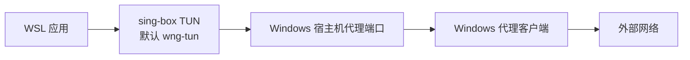

# wsl-netguard

`wsl-netguard` 是一个面向 WSL 的网络守卫 CLI：在 WSL 内通过 `sing-box` TUN 接管出站流量，把流量转发到 Windows 宿主机上的 SOCKS5 / HTTP 代理，并用 `nftables` kill switch 防止代理不可用时直连外部网络。

> 状态提示：项目仍处于早期 MVP 阶段，目前仅在 WSL Debian 中做过简单测试。启用后会修改 systemd 服务、TUN 接口和受管理的 nftables 表，请谨慎使用，并先确认 `disable` / `rescue` 恢复路径可用。

## 目录

- [项目概览](#项目概览)
- [环境要求](#环境要求)
- [安装](#安装)
- [配置](#配置)
- [域名透传与 DNS](#域名透传与-dns)
- [启用与验证](#启用与验证)
- [卸载与残余清理](#卸载与残余清理)
- [安全边界](#安全边界)
- [故障排查](#故障排查)
- [开发与发布](#开发与发布)
- [许可证](#许可证)

## 项目概览

### 解决的问题

- WSL 内只配置 `http_proxy` / `all_proxy` 覆盖不完整，部分程序仍可能直连。
- WSL2 的 Windows 宿主机地址可能随重启变化，静态代理配置容易失效。
- Windows 代理客户端关闭或端口不可达时，WSL 可能绕过代理直接访问外部网络。
- 手写 nftables 规则出错可能导致 WSL 断网，且误用 `flush ruleset` 会影响 Docker、Kubernetes、kind、k3s 或用户已有防火墙规则。

### 工作方式



`wsl-netguard` 会动态检测 Windows 宿主机 IP，并在检测默认网关时排除自己管理的 TUN 接口，避免把 `wng-tun` 误判为原始网关。

### 支持范围

- 支持 Windows 侧 SOCKS5 或 HTTP 代理端口。
- 不绑定具体代理客户端；v2rayN、Clash Verge / Mihomo、sing-box、Hiddify、NekoRay 等只要能让 WSL 访问本地代理端口即可。
- 不管理 Windows 代理软件的节点、订阅、分流规则、登录状态或开机启动。
- 不修改 Windows 防火墙。
- 不保证 `ping` 经过代理，因为 SOCKS5 / HTTP 代理通常不代理 ICMP。

## 环境要求

Windows 侧：

- 代理客户端正在运行，并监听 SOCKS5 或 HTTP 端口。
- 已开启 Allow LAN / 允许局域网连接，或监听到 WSL 可访问的地址。
- Windows 防火墙允许 WSL 访问该代理端口。

WSL 侧：

- systemd 可用。
- 已安装 `nft`、`ip`、`curl`。
- `/dev/net/tun` 可用。
- 需要修改 systemd、nftables、接口和 `/etc` 时使用 `sudo`。

一键安装脚本会尝试安装常见基础依赖，并默认安装受管理的 `sing-box v1.13.13` 到 `/usr/local/lib/wsl-netguard/sing-box`。

## 安装

### 在线安装

```bash
curl -fsSL https://raw.githubusercontent.com/shanlvb/wsl-netguard/main/install.sh | bash
```

默认安装会：

- 检查当前环境是否为 WSL。
- 尝试安装 `ca-certificates`、`curl`、`tar`、`coreutils`、`iproute2`、`nftables` 等基础依赖。
- 从 GitHub Releases 下载当前架构的 `wsl-netguard` 包并校验 `checksums.txt`。
- 执行 `sudo wsl-netguard install` 写入受管理文件。
- 下载并校验固定版本的受管理 `sing-box`。

默认安装不会启用网络接管，也不会应用 kill switch。安装后先诊断：

```bash
wsl-netguard doctor
```

确认依赖和代理端口正常后再启用：

```bash
sudo wsl-netguard enable
```

安装后立即启用：

```bash
curl -fsSL https://raw.githubusercontent.com/shanlvb/wsl-netguard/main/install.sh | bash -s -- --enable
```

常用安装参数：

```bash
# 安装指定版本
curl -fsSL https://raw.githubusercontent.com/shanlvb/wsl-netguard/main/install.sh | bash -s -- --version v0.1.0

# 跳过系统包安装
curl -fsSL https://raw.githubusercontent.com/shanlvb/wsl-netguard/main/install.sh | bash -s -- --no-deps

# 跳过受管理 sing-box 安装，需要自行提供 /usr/local/lib/wsl-netguard/sing-box
curl -fsSL https://raw.githubusercontent.com/shanlvb/wsl-netguard/main/install.sh | bash -s -- --no-sing-box

# 也可以通过环境变量跳过受管理 sing-box 安装
curl -fsSL https://raw.githubusercontent.com/shanlvb/wsl-netguard/main/install.sh | WSL_NETGUARD_INSTALL_SING_BOX=0 bash
```

### 国内加速 / GitHub 加速

如果访问 GitHub raw 或 release 产物较慢，可以使用可信的 GitHub 加速前缀。下面以 `https://gh-proxy.com/` 为例：

```bash
curl -fsSL https://gh-proxy.com/https://raw.githubusercontent.com/shanlvb/wsl-netguard/main/install.sh | WSL_NETGUARD_GITHUB_PROXY=https://gh-proxy.com/ bash
```

也可以作为参数传入：

```bash
curl -fsSL https://gh-proxy.com/https://raw.githubusercontent.com/shanlvb/wsl-netguard/main/install.sh | bash -s -- --github-proxy https://gh-proxy.com/
```

这类第三方加速服务不是本项目或 GitHub 官方服务，只有在你可信任该服务时才使用。若加速服务不支持 GitHub API 的 latest 查询，可以指定版本安装。

### 手工安装

以 `linux_amd64` 和 `v0.1.0` 为例：

```bash
curl -LO https://github.com/shanlvb/wsl-netguard/releases/download/v0.1.0/wsl-netguard_v0.1.0_linux_amd64.tar.gz
curl -LO https://github.com/shanlvb/wsl-netguard/releases/download/v0.1.0/checksums.txt
sha256sum -c checksums.txt --ignore-missing
tar -xzf wsl-netguard_v0.1.0_linux_amd64.tar.gz
sudo install -m 0755 wsl-netguard_v0.1.0_linux_amd64/wsl-netguard /usr/local/bin/wsl-netguard
sudo wsl-netguard install
```

ARM64 WSL 请下载 `linux_arm64` 产物。手工安装时需要自行准备 `/usr/local/lib/wsl-netguard/sing-box`，否则 `doctor` 会报告缺少必需依赖，`enable` 也会失败。

## 配置

默认配置文件：

```text
/etc/wsl-netguard/config.json
```

默认配置：

```json
{
  "mode": "dev",
  "proxy_protocol": "socks",
  "socks_port": 10808,
  "http_port": 10809,
  "tun_interface": "wng-tun",
  "tun_address": "172.19.0.1/30",
  "dns_strategy": "ipv4_only"
}
```

| 字段 | 默认值 | 说明 |
| --- | --- | --- |
| `mode` | `dev` | 网络边界模式：`dev` 或 `strict` |
| `proxy_protocol` | `socks` | 上游代理协议：`socks` 或 `http` |
| `socks_port` | `10808` | Windows 宿主机 SOCKS5 代理端口 |
| `http_port` | `10809` | Windows 宿主机 HTTP 代理端口 |
| `tun_interface` | `wng-tun` | 受管理 TUN 接口名 |
| `tun_address` | `172.19.0.1/30` | TUN 接口 IPv4 CIDR |
| `dns_strategy` | `ipv4_only` | 当前 FakeIP 仅支持此值；其他策略在生成配置时明确报错 |

常用命令：

```bash
wsl-netguard config show
sudo wsl-netguard config set mode dev
sudo wsl-netguard config set mode strict
sudo wsl-netguard config set proxy-protocol socks
sudo wsl-netguard config set proxy-protocol http
sudo wsl-netguard config set socks-port 10808
sudo wsl-netguard config set http-port 10809
sudo wsl-netguard config set tun-interface wng-tun
```

v2rayN 常见混合端口是 `10808`，通常保持 SOCKS 配置即可：

```bash
sudo wsl-netguard config set proxy-protocol socks
sudo wsl-netguard config set socks-port 10808
```

如果你的代理客户端只提供 HTTP 端口：

```bash
sudo wsl-netguard config set proxy-protocol http
sudo wsl-netguard config set http-port 7890
sudo wsl-netguard restart
```

## 域名透传与 DNS

默认启用 IPv4 FakeIP，适用于 sing-box 1.13.13。被 TUN 接管的 TCP/UDP 53 端口 DNS 查询中，A 返回 `198.18.0.0/15` 内的虚拟地址，AAAA 返回空答案。应用连接虚拟地址时，sing-box 恢复原始域名，经 SOCKS5 域名请求或 HTTP CONNECT 交给 Windows 代理。SSH、MySQL 等服务端先发数据的协议不依赖 HTTP/TLS 嗅探，也不会被 CNAME 或 SNI 替换原始域名。

例如：`codeup.aliyun.com → FakeIP → SOCKS5 codeup.aliyun.com:22 → Windows 域名规则 → 外部解析并连接`。WSL 不维护业务域名白名单或国内外分流规则，也没有解析失败后直连的回退。

HTTPS 即使在访问日志中显示 IP，也可能由 Windows 侧通过 TLS 嗅探命中域名规则；域名拼写错误应先修正。FakeIP 的主要价值是统一保留原始域名，覆盖 SSH、MySQL 等无法依靠 HTTP/TLS 嗅探的协议，而非修复所有 HTTPS 分流问题的必要条件。

真实地址解析由 Windows 代理及后续出站决定。配置了“直连 DNS / 远程 DNS”不代表它们一定用于最终连接；以 v2rayN 为例，目标解析策略为空或 `AsIs` 时，直连可能使用 Windows 系统 DNS，代理可能由远端服务器解析。要使用指定的国内 / 国外 DNS，还需配置外部代理的对应目标解析策略。netguard 不修改这些设置。

| 情形 | 行为与边界 |
| --- | --- |
| TXT、SRV、MX、HTTPS、SVCB 等非地址查询 | 保留经代理访问 `1.1.1.1` DoH 的路径，不交给 FakeIP；HTTPS/SVCB 地址提示可能让应用直接使用真实 IP |
| 直接 IP、hosts、已有真实 IP 缓存、应用自带 DoH/DoT | 保持 IP 转发，不猜测原域名；不保证命中外部域名规则 |
| 回环与 hosts | 保留现有 NSS/hosts 和回环路径；绕过 hosts 直接查询 DNS 的应用不享有该保证 |
| Docker 服务名 | 保留 Docker `127.0.0.11` 内部服务发现；其外部查询与后续连接必须都经过同一 netguard |
| 私有 DNS / 内网域名 | 不自动猜测本地域名；若查询被接管，外部必须能够解析并访问目标。域名指向回环时尤其需要注意连接发生在哪台机器 |
| UDP | 依赖 SOCKS5 上游 UDP 支持；HTTP 代理不支持普通 UDP，不自动切换协议 |
| IPv6 | 当前只提供 IPv4 虚拟地址，不宣称支持 IPv6 TUN；外部代理最终选用 IPv4/IPv6 由其自行决定 |

`198.18.0.0/15` 专用于 FakeIP，不应与实际业务网络或现有路由重叠；配置中的 TUN 地址若重叠会报错。不存在的域名可能到连接时才失败。FakeIP 不适合依赖真实 IP 做判断、ICMP 诊断或把解析结果交给另一台机器的程序。

Docker 转发保护仅匹配从 `docker0`、`br-*` 进入的流量：允许进入 TUN，保留模式允许的本地通信和已建立入站连接的回复，其余丢弃。只向工具自己的 nftables 表添加规则，不改 Docker 表；其他防火墙仍可能拒绝流量。自定义桥名称、macvlan、其他容器网络不属于此覆盖范围。

### 升级、重启与停用

映射保存在 `/var/lib/wsl-netguard/cache.db`，由 systemd 创建权限为 `0700` 的状态目录，服务使用 `UMask=0077`。正常重启、`disable` 和 `rescue` 保留映射；`uninstall` 删除该缓存，保留目录中的其他文件。缓存包含查询过的域名，不应公开分享。

从旧版本升级必须重新执行新版 `install` 更新 systemd unit，并执行 `systemctl daemon-reload`，再启用或重启服务；仅替换二进制不足以安装状态目录配置。默认 `ipv4_only` 配置无需增加字段，旧的其他 DNS 策略需先改为 `ipv4_only`；旧配置仍可用于 `disable` / `rescue`。

启用前已有的真实 IP 缓存和连接不会自动转换成域名连接，需要重新解析、重建连接。停用后，仍缓存 FakeIP 的应用需要重启或清理其自身 DNS 缓存；工具只提示，不自动清理任意应用缓存。不要在服务运行时删除映射缓存。正常重启的映射保留已验证，但异常断电不能保证所有异步写入已落盘；缺失映射会拒绝连接，不把未知虚拟地址发往上游。

## 启用与验证

建议流程：

1. 启动 Windows 代理客户端，并确认允许 WSL 访问代理端口。
2. 执行 `wsl-netguard doctor` 检查依赖、TUN、DNS、Windows 宿主机 IP 和代理端口。
3. 执行 `wsl-netguard render` 预览将生成的 `sing-box.json` 和 `nftables.nft`。
4. 执行 `sudo wsl-netguard enable` 启用 TUN 和 kill switch。
5. 执行 `wsl-netguard status` 和 `wsl-netguard test` 验证代理出口与直连阻断。

常用命令：

| 命令 | 说明 |
| --- | --- |
| `wsl-netguard doctor` | 诊断环境和代理端口，不修改系统 |
| `wsl-netguard render` | 只渲染配置到标准输出 |
| `sudo wsl-netguard enable` | 启用网络接管和 kill switch |
| `wsl-netguard status` | 查看模式、宿主机 IP、代理端口、TUN 和 kill switch 状态 |
| `wsl-netguard test` | 测试代理出口、DNS 和直连阻断 |
| `sudo wsl-netguard restart` | 重新渲染运行时配置并重启服务 |
| `wsl-netguard logs` | 查看相关 systemd journal 日志 |
| `sudo wsl-netguard disable` | 停止网络接管并删除运行时资源 |
| `sudo wsl-netguard rescue` | 尽力恢复，适合配置缺失或服务状态异常时使用 |
| `sudo wsl-netguard uninstall` | 禁用并删除受管理安装文件 |

网络模式：

- `dev`：默认模式，阻止 WSL 直连外部网络，同时保留 WSL 与 Windows 宿主机之间的开发通信，并允许 WSL 本机访问 Docker bridge 容器网络。
- `strict`：只允许访问 Windows 宿主机上的配置代理端口，可能影响 IDE、调试器、语言服务器和 dev server 流量。

切换模式：

```bash
sudo wsl-netguard mode strict
sudo wsl-netguard mode dev
sudo wsl-netguard restart
```

验证代理出口时优先使用 HTTP 请求，不要用 `ping` 作为主要依据：

```bash
curl https://api.ipify.org
curl --max-time 8 https://api.ipify.org
```

## 卸载与残余清理

### 临时禁用

```bash
sudo wsl-netguard disable
```

`disable` 会停止相关 systemd 服务，删除 `table inet wsl_netguard`，删除受管理 TUN 接口，并清理 `/run/wsl-netguard`。它会保留安装文件、配置和 FakeIP 映射缓存。停用后请重启仍缓存虚拟地址的应用，或清理该应用的 DNS 缓存。

### 正常卸载

```bash
sudo wsl-netguard uninstall
```

`uninstall` 会先执行恢复动作，再清理受管理安装内容：

- `/usr/local/bin/wsl-netguard`
- `/usr/local/lib/wsl-netguard`
- `/etc/wsl-netguard/config.json`
- `/etc/wsl-netguard/sing-box.template.json`
- `/etc/systemd/system/wsl-netguard-killswitch.service`
- `/etc/systemd/system/wsl-netguard-sing-box.service`
- `/run/wsl-netguard`
- `/var/lib/wsl-netguard/cache.db`（仅删除此文件，目录非空时保留）
- `table inet wsl_netguard`
- 默认或配置中的 TUN 接口

如果 `/etc/wsl-netguard` 内还有你手工放入的其他文件，内置卸载会保留该目录。

### 完全清理残余

当 CLI 已损坏、卸载中断，或你想确认残余文件全部清理时，可以按需执行下面的受管理资源清理命令：

```bash
sudo systemctl stop wsl-netguard-sing-box.service 2>/dev/null || true
sudo systemctl stop wsl-netguard-killswitch.service 2>/dev/null || true
sudo systemctl disable wsl-netguard-sing-box.service 2>/dev/null || true
sudo systemctl disable wsl-netguard-killswitch.service 2>/dev/null || true
sudo nft delete table inet wsl_netguard 2>/dev/null || true
sudo ip link delete wng-tun 2>/dev/null || true
sudo rm -rf /run/wsl-netguard
sudo rm -f /etc/systemd/system/wsl-netguard-sing-box.service
sudo rm -f /etc/systemd/system/wsl-netguard-killswitch.service
sudo rm -f /usr/local/bin/wsl-netguard
sudo rm -rf /usr/local/lib/wsl-netguard
sudo rm -f /etc/wsl-netguard/config.json
sudo rm -f /etc/wsl-netguard/sing-box.template.json
sudo rmdir /etc/wsl-netguard 2>/dev/null || true
sudo rm -f /var/lib/wsl-netguard/cache.db
sudo rmdir /var/lib/wsl-netguard 2>/dev/null || true
sudo systemctl daemon-reload
sudo systemctl reset-failed wsl-netguard-sing-box.service wsl-netguard-killswitch.service 2>/dev/null || true
```

如果你修改过 `tun_interface`，请把上面的 `wng-tun` 替换为实际接口名。

如果你确认 `/etc/wsl-netguard` 内没有需要保留的自定义文件，也可以删除整个残余配置目录：

```bash
sudo rm -rf /etc/wsl-netguard
```

不要执行 `nft flush ruleset`；它会清空系统 nftables 规则，可能破坏 Docker、Kubernetes、kind、k3s 或发行版管理的规则。

## 安全边界

`wsl-netguard` 只应创建、修改或删除以下受管理资源：

```text
/usr/local/bin/wsl-netguard
/usr/local/lib/wsl-netguard/sing-box
/etc/wsl-netguard/config.json
/etc/wsl-netguard/sing-box.template.json
/etc/systemd/system/wsl-netguard-killswitch.service
/etc/systemd/system/wsl-netguard-sing-box.service
/run/wsl-netguard/sing-box.json
/run/wsl-netguard/nftables.nft
/run/wsl-netguard/nftables.check.nft
/run/wsl-netguard/state.json
/var/lib/wsl-netguard/cache.db
table inet wsl_netguard
wng-tun
```

关键约束：

- 恢复优先于启用：优先使用 `disable`、`uninstall`、`rescue`。
- `install` 默认不启用网络接管，除非显式传入 `--enable`。
- `enable` 和 `restart` 会动态检测 Windows 宿主机 IP，不硬编码宿主机地址。
- 只删除工具自己的 `table inet wsl_netguard`，不删除用户或其他软件的 nftables 表。
- 修改系统状态的命令需要 root 权限；请显式使用 `sudo`。

## 故障排查

### 代理端口不可达

检查 Windows 代理客户端是否运行、端口是否与配置一致、是否允许局域网连接，以及 Windows 防火墙是否允许 WSL 访问该端口。

```bash
wsl-netguard doctor
wsl-netguard config show
```

### 启用后无法上网

先查看状态和日志：

```bash
wsl-netguard status
wsl-netguard logs
```

立即恢复：

```bash
sudo wsl-netguard disable
```

### Windows 宿主机 IP 变化

```bash
sudo wsl-netguard restart
```

### 开发工具连接异常

如果当前是 `strict` 模式，先切回 `dev`：

```bash
sudo wsl-netguard mode dev
sudo wsl-netguard restart
```

### 本地集群或容器异常

`dev` 模式会放行 Docker 默认 bridge 和用户自定义 bridge 网络，Windows 宿主机通过 `127.0.0.1:<发布端口>` 访问 WSL Docker 服务时不应被 kill switch 阻断。

`strict` 模式仍可能影响 Docker、Kubernetes、kind 或 k3s 的本地网络访问。出现异常时先恢复：

```bash
sudo wsl-netguard disable
```

## 开发与发布

常用检查：

```bash
go fmt ./...
go test ./...
go test -cover ./...
```

FakeIP 协议集成测试（本地回环端口和临时文件，不修改系统网络）：

```bash
WSL_NETGUARD_SING_BOX=/usr/local/lib/wsl-netguard/sing-box \
go test -race ./internal/render -run TestFakeIP -v
```

测试使用真实 sing-box 1.13.13 和模拟上游，验证域名/端口、服务端先发数据、地址族、映射正常重启与缺失映射拒绝。非地址 DNS 测试用可控 TCP DNS 替换公共 DoH，验证规则选择和代理路径。未设置变量时跳过协议集成测试。真实 WSL TUN、Docker 转发/服务发现/发布端口、上游 UDP 和 v2rayN 分流仍需部署后的现场验收，不能由这些本地测试代替。

本地构建：

```bash
make build
bin/wsl-netguard version
```

发布版本由 GitHub Actions 在推送 `v*` tag 时构建 `linux/amd64` 和 `linux/arm64` release 包、生成 `checksums.txt` 并创建 GitHub Release。

## 许可证

本项目使用 [MIT License](LICENSE) 发布。
